# Belka AI · Generative AI for Engineering — FIAP GS 2026.2

**Olhar longe. Proteger perto.**

> **Protótipo acadêmico de orientação ambiental.** A Belka AI não prevê diretamente desastres, não emite alertas oficiais e não substitui a Defesa Civil. As previsões meteorológicas são dados de modelos; as respostas da IA podem conter erros.

## 1. Objetivo

A Belka é uma proposta voltada à comunicação acessível sobre **enchentes e inundações, deslizamentos, incêndios e ondas de calor**. O componente desenvolvido nesta matéria consulta conhecimentos com fontes, responde em português e, quando aplicável, usa dados meteorológicos do Open-Meteo para apoiar explicações. Não há modelo preditivo de ocorrência de desastres treinado neste repositório.

Ficha técnica: [descrição do componente](docs/ficha_tecnica.md). O projeto propõe contribuir com a meta 11.5 dos ODS, apoiando o acesso a orientações de prevenção, e com a meta 13.3, apoiando a educação sobre riscos climáticos.

Repositório: https://github.com/fernandakaory/gs-belka-genai.  
Vídeo: [demonstração da Belka Gen AI no YouTube](https://youtu.be/IN0QhtyyTC8).

O projeto compara cinco configurações:

| Configuração | Componentes |
|---|---|
| `baseline` | Qwen original, sem RAG |
| `rag` | Qwen + busca de trechos por palavras |
| `rag_lora` | Qwen + RAG + adapter LoRA |
| `agent` | Qwen + RAG + seleção de ferramentas por regras |
| `agent_lora` | Qwen + RAG + adapter LoRA + seleção de ferramentas |

O agente é **baseado em regras**: não faz planejamento autônomo pela LLM. As ferramentas incluem busca na base e consulta meteorológica, quando a pergunta permite. O modelo Qwen original é servido pelo **Ollama**; os modos LoRA usam **Transformers + PEFT**. Não se afirma que o Ollama carrega o adapter LoRA.

## 2. Arquitetura e tecnologias



[Ver imagem em tamanho original](img/Belka-genai-drawio.png) | [Versao editavel no draw.io](docs/arquitetura.drawio)

`Usuário → interface HTML → FastAPI → RAG/agente/Open-Meteo → Qwen (Ollama ou PEFT) → validação da saída → resposta`

- Python 3.11, FastAPI, Uvicorn e HTTPX;
- Qwen 2.5 1.5B (`qwen2.5:1.5b` no Ollama; `Qwen/Qwen2.5-1.5B-Instruct` na inferência LoRA);
- PyTorch, Transformers, PEFT e CUDA para treinamento/inferência LoRA;
- busca de conhecimento por palavras — **sem embeddings**;
- Open-Meteo para informações meteorológicas;
- JSON com campos `resposta` e `citacoes`, com verificações estruturais e de IDs.

A verificação de estrutura e de citações **não prova informações corretas ou apoiadas pelas fontes**. O campo `fundamentada` da API não representa certificação de verdade.

## 3. Conteúdo do repositório

```text
app/           API, coordenação, Ollama, LoRA, RAG, ferramentas, meteorologia e HTML
base/          fontes.json (9 fontes) e trechos.jsonl (24 trechos K01–K24)
treinamento/   train.jsonl, val.jsonl, test.jsonl e script de treinamento LoRA
outputs/       belka-lora/ com adapter PEFT treinado e configuração
avaliacao/     casos_teste.json e resultados reais em JSON/CSV
scripts/       avaliação de recuperação e comparação de cinco configurações
notebooks/     notebooks de avaliação e LoRA/agente
tests/         testes automatizados
docs/          relatório técnico, arquitetura, cinco erros e documentos auxiliares
img/           evidências de execução do projeto
```

Os dois notebooks contêm **saídas salvas**, sem erros registrados nas células de código inspecionadas. Eles apresentam os resultados dos arquivos existentes; sua execução não representa novo treinamento ou nova rodada de inferências. Consulte `docs/relatorio.md` e `docs/analise_cinco_erros.md` para metodologia, resultados e limites.

## 4. Preparação do ambiente (Windows 11 + Git Bash no VS Code)

Pré-requisitos: **Python 3.11**, **Ollama** instalado; para os modos LoRA, ambiente compatível com PyTorch e memória de GPU suficiente. A execução originalmente registrada utilizou Windows 11, Python 3.11.9 e NVIDIA RTX 5060 Ti de 8 GB. A instalação de PyTorch/CUDA pode variar conforme a máquina.

Na raiz do repositório:

```bash
python -m venv .venv
source .venv/Scripts/activate
python -m pip install -r requirements-lora.txt
ollama pull qwen2.5:1.5b
```

`requirements-lora.txt` inclui `requirements.txt` e as bibliotecas necessárias ao adapter. Se a instalação do PyTorch não reconhecer sua GPU, verifique a versão CUDA adequada no site oficial do PyTorch; **não é necessário retreinar** para usar o adapter já distribuído.

O código não carrega `.env` automaticamente. Para personalizar o Ollama, defina as variáveis no terminal antes de iniciar a API. Exemplo em Git Bash:

```bash
export OLLAMA_URL=http://localhost:11434
export OLLAMA_MODEL=qwen2.5:1.5b
```

Esses valores já são os padrões. Selecione o modo demonstração pela interface ou pelo campo `demo` da requisição. As variáveis `BELKA_DEMO_MODE` e `WEATHER_TIMEOUT_SECONDS` não são lidas pela implementação atual. Não publique `.env`, tokens ou segredos.

> Dependências não estão completamente fixadas em versões exatas. Portanto, reproduzir os resultados numéricos idênticos em outra máquina/versão **não é garantido**.

## 5. Executar a API e a interface

Com Ollama iniciado (aplicativo ou, caso necessário, `ollama serve` em outro terminal), rode:

```bash
uvicorn app.main:app --reload
```

Acesse:

- Interface: http://127.0.0.1:8000/
- Documentação interativa da API: http://127.0.0.1:8000/docs
- Saúde: http://127.0.0.1:8000/health

Endpoints principais: `POST /api/perguntar`, `GET /api/busca`, `GET /api/fontes`, `GET /api/clima` e `GET /health`.

Exemplo de requisição com Git Bash:

```bash
curl -X POST http://127.0.0.1:8000/api/perguntar \
  -H 'Content-Type: application/json' \
  -d '{"pergunta":"Quais são sinais de deslizamento?","configuracao":"rag","demo":false}'
```

A escolha `rag_lora` ou `agent_lora` exige o adapter em `outputs/belka-lora/` e as dependências LoRA. Open-Meteo exige conexão de rede quando a consulta meteorológica for acionada. O **modo demonstração** não executa inferência real por LLM e não deve ser contado como avaliação da IA.

## 6. Dados, fontes e avaliação do RAG

A base contém nove fontes catalogadas em `base/fontes.json` e 24 trechos em `base/trechos.jsonl`, cada um associado a uma fonte. Os testes gabaritados estão em `avaliacao/casos_teste.json`: **12 perguntas respondíveis e 5 casos “não consta”**.

Para repetir somente a avaliação da busca por palavras (sem inferência de LLM):

```bash
python -m scripts.avaliar_busca
```

Resultados já registrados em `avaliacao/metricas_busca_executadas.json`:

| Limiar | Recall@1 | Recall@3 | Falsos positivos em 5 “não consta” |
|---|---:|---:|---:|
| 0,20 | 66,7% | 100% | 1 |
| 0,50 | 66,7% | 100% | 1 |
| 1,00 | 66,7% | 100% | 1 |
| 1,50 | 66,7% | 91,7% | 0 |
| 2,00 | 50,0% | 66,7% | 0 |

**Limiar adotado: 0,20**, privilegiando Recall@3 nos casos respondíveis. Há um falso positivo entre os cinco casos sem resposta; recuperação de trecho não significa que o trecho responda à pergunta.

## 7. Dataset e treinamento LoRA — já realizados

Os conjuntos em `treinamento/` têm **138 exemplos de treino, 36 de validação e 36 de teste** (210 no total). Foram usados dados supervisionados para formato JSON, citações, orientações e recusas, **não** para prever desastres. Perguntas não se repetem literalmente entre splits, mas há conhecimento e evidências compartilhados.

O treino já realizado usou `Qwen/Qwen2.5-1.5B-Instruct`, CUDA, 2 épocas, rank 8, alpha 16, `lr=0.0001`, acumulação 8, `max_length=768` e seed 42. Foram registrados 36 passos e 1.089.536 parâmetros treináveis. Resultados das épocas (treino/validação): **1,2794/0,8038** e **0,9187/0,7308**. O adapter está em `outputs/belka-lora/` e o resumo da execução em `training_run.json`.

O comando histórico para **treinar novamente, apenas se necessário**, é:

```bash
python -m treinamento.treinar_lora --epochs 2 --rank 8
```

Para a avaliação original vs. LoRA, o script é `avaliacao/avaliar_lora.py`, e os resultados preservados estão em `avaliacao/resultados_lora.json`. No conjunto de 36 casos, a Qwen original teve **0/36 JSONs válidos**, contra **36/36** com LoRA; o adapter também teve **6/6 recusas corretas** sob a métrica implementada. Essas métricas de conformidade **não demonstram equivalência em correção do conteúdo**. Foram observadas respostas muito curtas e incompletas. Não há necessidade de repetir essa avaliação para documentar resultados já obtidos.

## 8. Placar comparativo — 85 registros de avaliação

Foi executado `scripts/avaliar_geracao.py` com 17 casos em cada uma das cinco configurações, **85 execuções e zero falhas de execução**, com modo demo e meteorologia ao vivo desativados para comparação.

São chamadas ao serviço: a ausência de evidências pode gerar recusa sem chamar o modelo. Os arquivos não registram separadamente quantas gerações efetivamente ocorreram.

| Configuração | JSON válido | Recusas identificadas (5 casos) | Gabarito citado (12 casos) |
|---|---:|---:|---:|
| `baseline` | 17,6% | 5/5 | 0/12 |
| `rag` | 94,1% | 5/5 | 9/12 |
| `rag_lora` | 100% | 5/5 | 11/12 |
| `agent` | 100% | 5/5 | 10/12 |
| `agent_lora` | 100% | 4/5 | 10/12 |

Nos indicadores automáticos disponíveis, `rag_lora` teve melhor resultado conjunto. **Não há comprovação de melhor qualidade geral das respostas**: a recusa é detectada por expressões textuais, e a métrica de gabarito verifica coincidência de IDs, não a validade da justificativa.

O avaliador atual considera até quatro trechos nos modos agente e três nos modos RAG; só aceita a fonte WEATHER quando há dados meteorológicos. Os resultados históricos foram preservados e ainda contêm a avaliação anterior do campo `citacoes_autorizadas`. A comparação do conteúdo das respostas continua pendente de revisão pela equipe, conforme o procedimento no relatório.

Resultados salvos:

- `avaliacao/resultados_comparacao_reais.json`
- `avaliacao/resultados_comparacao_reais.csv`
- `avaliacao/placar_comparacao_reais.json`
- `docs/analise_cinco_erros.md` — cinco ocorrências reais, com propostas de correção **não comprovadas por nova avaliação**.

Para **reexecutar as 85 inferências**, apenas quando houver necessidade e com Ollama/modelos acessíveis:

```bash
python -m scripts.avaliar_geracao --modes baseline rag rag_lora agent agent_lora
```

**Atenção:** esse script **sobrescreve** os arquivos de resultados comparativos. Preserve uma cópia dos resultados originais antes de reexecutá-lo. Para um ensaio breve, o script aceita `--limit 3`, mas isso também sobrescreve os arquivos de saída; não use sem preservá-los.

## 9. Testes automatizados

```bash
python -m pytest -q
```

O histórico documenta **13 testes aprovados e um aviso** em uma versão anterior. A revisão documental da Etapa F6 não reexecutou a suíte; esse número não é apresentado como validação atual. Existem capturas locais de API/agente (`img/16-validacao-final-api-agente-1.png` e `img/16-validacao-final-api-agente-2.png`) e interface (`img/17-validacao-final-interface.png`), cujo conteúdo ainda deve ser conferido antes de declarar a validação final concluída.

## 10. Limitações e precauções

- Busca por palavras pode selecionar trechos relacionados sem fornecer evidência suficiente; o limiar escolhido não elimina falsos positivos.
- As regras de validação restringem formato e IDs, mas não garantem interpretação correta dos documentos.
- O LoRA melhorou indicadores estruturais, porém apresentou respostas com conteúdo limitado em casos analisados.
- O agente escolhe ferramentas por regras; a combinação de agente com LoRA não foi a melhor em todas as métricas.
- Dados meteorológicos não são alertas oficiais nem permitem derivar, por si sós, probabilidade confiável de desastre em um endereço.
- Publicação da interface e da API em URL pública e integração efetiva com o componente Big Data **não estão comprovadas neste repositório**. Não apresentar funcionalidades do MVP integrado como entregues sem evidência específica.
- Para situações de perigo, devem prevalecer orientações e canais oficiais de Defesa Civil.

## 11. Fontes e documentação

- Fontes catalogadas com URLs: `base/fontes.json` e `docs/fontes_ampliadas.md`.
- Relatório técnico: `docs/relatorio.md`.
- Cinco erros reais: `docs/analise_cinco_erros.md`.
- Arquitetura e decisões técnicas: `docs/arquitetura.md` e `docs/relatorio.md`.
- Diretrizes de comunicação usadas pelos trechos K09 e K10: `docs/diretrizes_belka.md`.
- [Open-Meteo](https://open-meteo.com/en/docs) · [Ollama](https://ollama.com/) · [PyTorch](https://pytorch.org/).

## Integrantes

| Nome | RM |
|---|---|
| Fernanda Kaory Saito | 551104 |
| João Pedro Borsato | 550294 |
| Maria Fernanda Camargo | 97956 |
| Pedro Lucas Nunes | 550366 |
