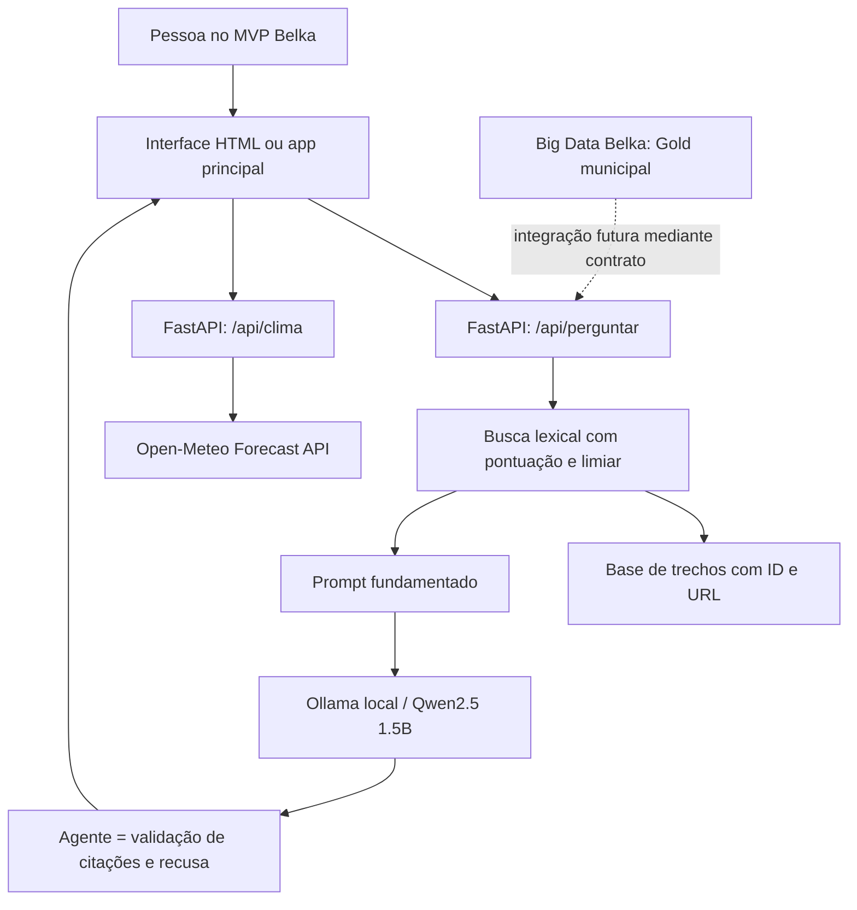

# Arquitetura — Belka Gen AI

## Responsabilidades

- Dados atuais: previsão meteorológica, sempre com timestamp; indisponibilidade explicitada.
- RAG: pesquisa material educativo e explicações sobre limites dos dados.
- Baseline: mesma LLM sem contexto. RAG: LLM + trechos. Agente: RAG + validação determinística.
- Nenhuma dessas configurações prevê ocorrência de desastre ou substitui alertas oficiais.
- O "agente" aqui é um pipeline especializado de seleção e validação; NÃO é LoRA nem um sistema autônomo de múltiplas ferramentas.
- O MVP não recolhe nome, CPF, email, endereço residencial ou localização automática.

## Contratos

POST /api/perguntar: `{ "pergunta": "...", "configuracao": "agent", "demo": false }`

GET /api/clima?latitude=-23.55&longitude=-46.63

GET /api/busca?pergunta=enchente

GET /api/fontes

Swagger: `/docs`

## Produção — NÃO implementado

Autenticação/rate limit/proxy HTTPS, auditoria sem dados sensíveis, cache, base oficial validada, revisão humana de mensagens críticas, cobertura de observações locais, CI/CD e monitoramento. Jamais encaminhar mensagens de evacuação automaticamente.
