# Arquitetura — Belka Gen AI

O diagrama mostra somente componentes implementados neste repositório. A versão editável está em [arquitetura.drawio](arquitetura.drawio), com páginas para respostas da IA e consulta direta de clima.

*Fluxo de respostas implementado: interface, API, busca, agente, modelos e verificacao da resposta.*

[Ver imagem em tamanho original](../img/Belka-genai-drawio.png) | [Abrir versao editavel no draw.io](arquitetura.drawio)

## Responsabilidades

- Dados atuais: previsão meteorológica, sempre com data e hora; indisponibilidade explicitada.
- RAG: pesquisa material educativo e explicações sobre limites dos dados.
- Baseline: modelo sem contexto. RAG: modelo + até três trechos. Agente: até quatro trechos e previsão quando aplicável. Os modos com LoRA carregam o ajuste treinado sobre o modelo base.
- Nenhuma dessas configurações prevê ocorrência de desastre ou substitui alertas oficiais.
- O agente seleciona busca e previsão por regras da pergunta. A verificação do JSON e das citações é aplicada a todas as respostas geradas.
- Não há campos dedicados a nome, CPF ou endereço. O texto livre pode conter dados pessoais inseridos pelo usuário; a interface deve orientar a não enviá-los. A localização não é coletada automaticamente.
- A demonstração retorna um trecho sem chamar o modelo. A falta de evidências pode gerar recusa antes da geração. O diagrama mostra o caminho de geração quando há contexto disponível.
- A consulta direta de clima pela interface não exige chamada ao modelo.

## Contratos

POST /api/perguntar: `{ "pergunta": "...", "configuracao": "agent", "demo": false }`

GET /api/clima?latitude=-23.55&longitude=-46.63

GET /api/busca?pergunta=enchente

GET /api/fontes

Swagger: `/docs`

