# Relatório técnico — Belka Gen AI

**Global Solution FIAP 2026.2 · Engenharia de Software · Generative AI for Engineering**

**Projeto:** Belka — *Olhar longe. Proteger perto.*  
**Natureza:** protótipo acadêmico experimental.
| Integrante | RM |
|---|---|
| Fernanda Kaory Saito | 551104 |
| João Pedro Borsato | 550294 |
| Maria Fernanda Camargo | 97956 |
| Pedro Lucas Nunes | 550366 |

### Ficha técnica do componente

| Campo | Descrição |
|---|---|
| Cidadão e território | Pessoas em cidades brasileiras que precisam de orientação sobre riscos ambientais; previsão disponível para coordenadas informadas e cidades cadastradas |
| Problema | Dificuldade de encontrar e compreender orientações de prevenção com fontes confiáveis |
| Proposta de valor | Respostas curtas em português, com citações e reconhecimento dos limites das informações |
| Tarefa da IA | Responder perguntas sobre enchentes, deslizamentos, incêndios e ondas de calor com apoio na base consultada |
| Entrada e saída | Pergunta em português; JSON com resposta, citações, modo e avisos |
| Componentes | Interface HTML, FastAPI, busca local, ferramentas meteorológicas e modelo Qwen original ou com LoRA |
| Participantes | Equipe Belka, cidadãos e fontes públicas; não há parceria formal comprovada com os órgãos citados |
| Indicadores técnicos | Recall@1/@3, formato JSON, citações, recusas e tempo de resposta |
| Impacto a medir | Compreensão das orientações e facilidade de encontrar informação, mediante testes futuros com usuários |
| Repositório | https://github.com/fernandakaory/gs-belka-genai |
| Vídeo de demonstração | [YouTube — Belka Gen AI](https://youtu.be/IN0QhtyyTC8) |
| MVP público | pendente |

### Contribuição aos ODS

- **ODS 11, meta 11.5:** apoiar o acesso a orientações de prevenção para pessoas expostas a desastres. A contribuição proposta é informativa.
- **ODS 13, meta 13.3:** apoiar a educação e a compreensão de riscos climáticos por meio de explicações simples, fontes e limites claros.

## 1. Contexto e objetivo

A Belka é uma proposta voltada à comunicação acessível de informações ambientais e orientações preventivas relacionadas a enchentes, deslizamentos, incêndios e ondas de calor. O projeto responde a perguntas do usuário com linguagem simples, consulta trechos documentados e, quando solicitado e disponível, consulta informações meteorológicas do Open-Meteo.

A tarefa da IA é **gerar respostas fundamentadas em evidências disponíveis, em JSON com os campos `resposta` e `citacoes`, e reconhecer perguntas que não podem ser respondidas**. Não se pretende prever diretamente a ocorrência de desastres por meio da Qwen, calcular risco científico validado ou substituir a Defesa Civil. Os indicadores eventualmente exibidos por outros componentes da Belka são experimentais e distintos dos alertas oficiais.

## 2. Arquitetura e configurações avaliadas

Fluxo do protótipo: **interface HTML → API FastAPI → recuperação RAG e/ou ferramentas selecionadas por regras → Qwen 2.5 1.5B (original ou com adapter LoRA) → validação/formatação JSON → resposta ao usuário**.

*Fluxo de respostas implementado: interface, API, busca, agente, modelos e verificacao da resposta.*

[Ver imagem em tamanho original](../img/Belka-genai-drawio.png) | [Abrir versao editavel no draw.io](arquitetura.drawio)

O modo demonstração copia um trecho da base sem chamar o modelo. Nos modos com contexto, a ausência de trechos e de previsão também pode produzir recusa antes da geração. Assim, os 85 registros da comparação representam chamadas ao serviço; não comprovam 85 chamadas ao modelo.

O sistema utiliza Qwen 2.5 1.5B, Ollama para a configuração original, PyTorch/Transformers/PEFT para inferência com LoRA, busca local por palavras, FastAPI e Open-Meteo. O componente chamado **agente** executa seleção de ferramentas por regras, como `rag_search` e `weather_forecast`: não é um agente autônomo que planeja livremente com a LLM.

As cinco configurações comparadas foram:

| Identificador | Configuração |
|---|---|
| `baseline` | Qwen original, sem RAG |
| `rag` | Qwen original + RAG |
| `rag_lora` | Qwen + adapter LoRA + RAG |
| `agent` | Qwen original + RAG + ferramentas selecionadas por regras |
| `agent_lora` | Qwen + adapter LoRA + RAG + ferramentas selecionadas por regras |

**Limitação metodológica:** a Qwen original e a inferência com adapter PEFT utilizam mecanismos distintos (Ollama e Transformers/PEFT). Portanto, a comparação mede o comportamento das configurações completas e não isola perfeitamente o efeito causal do LoRA.

## 3. Fontes e base de conhecimento

A base possui **9 fontes catalogadas** em `base/fontes.json` e **24 trechos** em `base/trechos.jsonl`, identificados por IDs e associados às suas fontes. Os trechos são paráfrases resumidas, não reproduções integrais de documentos. O catálogo atual contém:

| ID | Fonte catalogada | Referência |
|---|---|---|
| S01 | Defesa Civil Nacional — Saiba como agir | https://www.gov.br/mdr/pt-br/assuntos/protecao-e-defesa-civil/saiba-como-agir |
| S02 | Open-Meteo Forecast API | https://open-meteo.com/en/docs |
| S03 | Open-Meteo Flood API | https://open-meteo.com/en/docs/flood-api |
| S04 | Diretrizes de comunicação e limites da Belka | `docs/diretrizes_belka.md` |
| S05 | Ministério da Saúde — Ondas de Calor | https://www.gov.br/saude/pt-br/assuntos/saude-de-a-a-z/o/ondas-de-calor |
| S06 | Cemaden — Portais oficiais de monitoramento | https://www.gov.br/cemaden/pt-br/assuntos/briefing-cemaden-cenad/06-11-2026-briefing-cemaden-cenad |
| S07 | Open-Meteo Historical Weather API | https://open-meteo.com/en/docs/historical-weather-api |
| S08 | Open-Meteo Historical Forecast API | https://open-meteo.com/en/docs/historical-forecast-api |
| S09 | Cemaden Educação — Campanha Prevenção Riscos de Desastres | https://educacao.cemaden.gov.br/wp-content/uploads/cemaden-educacao/Campanha-Prevencao-Riscos-de-Desastres_SECLIMA-1.pdf |

O cadastro das fontes externas informa acesso em **09/11/2026**. A presença de uma URL no catálogo não implica validação externa independente, nesta auditoria, da integridade de cada página ou de suas licenças. Para as fontes externas, o próprio catálogo orienta verificar termos de reutilização.

| Fonte | Formato de origem | Licença ou situação de uso registrada | Trechos |
|---|---|---|---:|
| S01 — Defesa Civil | Página web | Termos de reutilização pendentes de confirmação | 7 |
| S02 — Open-Meteo Forecast | Documentação web e API JSON | Licença e limites do serviço pendentes de confirmação | 4 |
| S03 — Open-Meteo Flood | Documentação web e API JSON | Licença e limites do serviço pendentes de confirmação | 2 |
| S04 — Diretrizes Belka | Markdown local | Material da equipe; autorização externa não aplicável | 2 |
| S05 — Ministério da Saúde | Página web | Termos de reutilização pendentes de confirmação | 3 |
| S06 — Cemaden | Página web | Termos de reutilização pendentes de confirmação | 3 |
| S07 — Open-Meteo Historical Weather | Documentação web e API JSON | Licença e limites do serviço pendentes de confirmação | 1 |
| S08 — Open-Meteo Historical Forecast | Documentação web e API JSON | Licença e limites do serviço pendentes de confirmação | 1 |
| S09 — Cemaden Educação | PDF | Termos de reutilização pendentes de confirmação | 1 |
| **Total** | Trechos armazenados em JSONL | Licenças externas ainda não validadas | **24** |

A referência local S04 foi atualizada para um documento das regras atuais do projeto, pois o resumo do manual de marca foi removido. Os textos e IDs K09 e K10 foram mantidos; essa mudança não representa uma nova avaliação ou consulta ao manual original.

## 4. Casos de teste e dataset LoRA

O conjunto `avaliacao/casos_teste.json` contém **17 perguntas**, sendo **12 respondíveis** no escopo da base e **5 perguntas “não consta”**, para as quais o sistema deve reconhecer insuficiência de informação, em vez de inventar respostas. Cada caso possui referências de gabarito para avaliação de recuperação/citação; o gabarito por ID não substitui avaliação do conteúdo.

Os dados de especialização LoRA, em formato JSONL com mensagens `system`, `user` e `assistant`, encontram-se em `treinamento/`:

| Conjunto | Exemplos | Recusas |
|---|---:|---:|
| `train.jsonl` | 138 | 18 |
| `val.jsonl` | 36 | 6 |
| `test.jsonl` | 36 | 6 |
| **Total** | **210** | **30** |

A inspeção e as verificações anteriores registraram ausência de perguntas literalmente repetidas entre os três conjuntos, de erros estruturais de JSON e de referências a evidências inexistentes. Os exemplos são sintéticos e os conjuntos compartilham conhecimentos/evidências semelhantes. **Não se demonstrou generalização a fontes integralmente inéditas.**

## 5. Metodologia e avaliação da recuperação RAG

A recuperação em `app/knowledge.py` é feita **por palavras**: padroniza e separa os termos e calcula uma pontuação conforme sua presença e frequência nos trechos; **não utiliza embeddings**. RAG simples usa até três trechos e os modos agente usam até quatro, acima do limiar de pontuação.

O script `scripts/avaliar_busca.py` avaliou Recall@1 e Recall@3 nos 12 casos respondíveis, além de falsos positivos nos cinco casos sem resposta. Resultados armazenados em `avaliacao/metricas_busca_executadas.json` (execução registrada em **09/11/2026**):

| Limiar | Recall@1 | Recall@3 | Falsos positivos entre 5 “não consta” |
|---:|---:|---:|---:|
| 0,20 | 66,7% | 100,0% | 1 |
| 0,50 | 66,7% | 100,0% | 1 |
| 1,00 | 66,7% | 100,0% | 1 |
| 1,50 | 66,7% | 91,7% | 0 |
| 2,00 | 50,0% | 66,7% | 0 |

**Decisão adotada:** manter o limiar operacional **0,20**, que preservou Recall@3 de 100% nos 12 casos respondíveis avaliados. A escolha aceita o compromisso de **um falso positivo entre cinco perguntas “não consta”**. O limiar 1,50 evitou esse falso positivo na amostra, porém reduziu Recall@3 para 91,7%. Essas conclusões são exploratórias, obtidas numa amostra pequena, e não constituem calibração clínica/operacional de alertas de desastre.

Exemplos analisados: no caso **T03**, K03 continha informações relevantes a sinais de deslizamento, mas outro trecho apareceu à frente na ordenação; em **T17**, a recuperação de trechos sobre deslizamentos não oferecia elementos para informar o minuto exato de uma ocorrência. Encontrar textos tematicamente próximos não equivale a possuir evidências suficientes para responder.

## 6. Treinamento e avaliação LoRA

O adapter foi treinado a partir de `Qwen/Qwen2.5-1.5B-Instruct` com PyTorch, Transformers e PEFT, conforme `treinamento/treinar_lora.py`. A execução está registrada em `outputs/belka-lora/training_run.json` e os pesos encontram-se em `outputs/belka-lora/adapter_model.safetensors`.

| Parâmetro | Valor registrado |
|---|---|
| Dispositivo | CUDA |
| Épocas | 2 |
| Rank LoRA | 8 |
| Learning rate | 0,0001 |
| Acumulação de gradientes | 8 |
| Comprimento máximo | 768 tokens |
| Seed | 42 |
| Passos de otimização | 36 |
| Loss de treinamento final | 0,9187 |

As anotações da execução registram loss de treinamento de **1,2794 → 0,9187** e loss de validação de **0,8038 → 0,7308** entre as épocas 1 e 2. Esses números não são medidas de precisão factual.

Uma avaliação separada (`avaliacao/avaliar_lora.py`, resultados em `avaliacao/resultados_lora.json`) realizou **36 inferências com Qwen original** e **36 com Qwen + LoRA** nos 36 exemplos de teste:

| Métrica | Original | Com LoRA |
|---|---:|---:|
| JSON válido | 0/36 | 36/36 |
| Decisão de recusa correta, exigindo JSON válido | 0/36 | 36/36 |
| Recusas corretas nos seis casos negativos | 0/6 | 6/6 |
| Citações exatas do gabarito | 0/36 | 36/36 |
| IDs de citação sem invenção | 0/36 | 36/36 |
| Tempo médio por inferência | 3,9199 s | 1,6843 s |

A maior conformidade de JSON, recusas e IDs no teste **não demonstra a mesma melhora em utilidade ou correção do conteúdo**. Na revisão qualitativa anterior, 18 das 30 respostas informativas do LoRA tiveram até três palavras; ocorreram respostas curtas ou incompletas e interpretações inadequadas de evidências. A causa exata não foi demonstrada. Os tempos não devem ser interpretados como ganho isolado de desempenho do LoRA, dado o uso de motores de inferência diferentes.

## 7. Comparação das cinco configurações

Foi executado `python -m scripts.avaliar_geracao --modes baseline rag rag_lora agent agent_lora`: **17 perguntas × 5 modos = 85 registros de avaliação**, com **zero falhas de execução registradas**. Para tornar a comparação de conhecimento mais reproduzível, a consulta meteorológica em tempo real e o modo demonstrativo foram desativados.

Arquivos produzidos: `avaliacao/resultados_comparacao_reais.json`, `avaliacao/resultados_comparacao_reais.csv` e `avaliacao/placar_comparacao_reais.json`.

| Métrica | Baseline | RAG | RAG + LoRA | RAG + agente | RAG + LoRA + agente |
|---|---:|---:|---:|---:|---:|
| Casos executados | 17/17 | 17/17 | 17/17 | 17/17 | 17/17 |
| JSON válido | 17,6% | 94,1% | 100% | 100% | 100% |
| Recusas identificadas nos cinco casos negativos | 5/5 | 5/5 | 5/5 | 5/5 | 4/5 |
| Gabarito citado nos 12 respondíveis | 0/12 | 9/12 | 11/12 | 10/12 | 10/12 |
| Falhas de execução | 0 | 0 | 0 | 0 | 0 |

### Interpretação de cada configuração

**1. Baseline — modelo sem contexto (`baseline`).** Apenas 3 dos 17 registros tiveram JSON válido (17,6%), e nenhum dos 12 casos respondíveis citou o gabarito. A ausência de citações é esperada nessa configuração, pois ela não recebe os documentos da base. Foram identificadas recusas nos cinco casos sem resposta, mas isso precisa ser lido junto das falhas de formato: o serviço também transforma saídas inválidas em recusa. Portanto, esse resultado não demonstra que o modelo reconheceu corretamente seus limites em todos esses casos. O baseline serve como referência e apresentou dificuldade para cumprir o formato exigido pelo produto.

**2. Modelo com busca na base (`rag`).** O JSON válido passou para 16 de 17 registros (94,1%), o gabarito foi citado em 9 dos 12 casos respondíveis e houve recusa identificada nos cinco casos negativos. Em comparação ao baseline, fornecer documentos esteve associado a melhores resultados de formato e citação. Ainda assim, encontrar e citar um trecho não garantiu apoio suficiente à resposta: em T12, a conclusão sobre chuva não garantir enchentes veio acompanhada de K02, enquanto K12 era a evidência mais direta. O RAG simples apresentou uma melhora clara nos indicadores medidos, com falhas pontuais de formato e escolha de fonte.

**3. Modelo com busca e ajuste LoRA (`rag_lora`).** Os 17 registros tiveram JSON válido, as cinco recusas esperadas foram identificadas e o gabarito apareceu em 11 dos 12 casos respondíveis. Em relação ao RAG simples, foram dois casos a mais com gabarito citado e um registro a mais com JSON válido. Isso indica melhor cumprimento do formato e das referências esperadas nesse conjunto. O resultado de 11/12 não equivale a uma taxa de 91,7% de respostas corretas: o indicador confere IDs e não avalia todas as afirmações. Além disso, a avaliação separada do LoRA registrou respostas curtas ou incompletas, que continuam sendo uma limitação a considerar.

**4. Modelo com busca e agente (`agent`).** Houve JSON válido nos 17 registros, recusa identificada nos cinco casos negativos e gabarito citado em 10 dos 12 casos respondíveis. Em comparação ao RAG simples, o agente apresentou um caso a mais com JSON válido e um a mais com gabarito citado. Essa configuração combina regras adicionais de validação e busca de até quatro trechos, enquanto o RAG usa até três; por isso, o ganho não pode ser atribuído apenas à seleção de ferramentas. A previsão meteorológica estava desativada no experimento, então esse placar não mede o benefício de consultar dados atualizados do clima.

**5. Modelo com busca, LoRA e agente (`agent_lora`).** Os 17 registros tiveram JSON válido e o gabarito foi citado em 10 dos 12 casos respondíveis, como no agente sem LoRA. Porém, houve recusa identificada em apenas quatro dos cinco casos negativos. Em T17, o sistema respondeu com orientações gerais sobre deslizamentos sem esclarecer que não poderia informar o minuto exato de uma ocorrência. A combinação de todos os componentes manteve o formato, mas não melhorou a citação do gabarito em relação ao agente e apresentou uma falha adicional de recusa. Esse resultado mostra que acrescentar componentes não garante melhora em todas as medidas.

### Qual configuração teve o melhor resultado?

**O RAG + LoRA (`rag_lora`) teve o melhor resultado conjunto nas três métricas principais deste experimento.** Empatou com os modos agente em JSON válido (100%), manteve cinco recusas identificadas e alcançou a maior quantidade de casos respondíveis com gabarito citado (11/12). Assim, é a configuração com melhor apoio nos números disponíveis para responder as perguntas com base nos documentos disponíveis.

O agente sem LoRA ficou próximo, com 10/12 gabaritos citados e as mesmas taxas de JSON e recusa. Sua capacidade de consultar previsão pode ser útil ao produto, mas precisa ser avaliada em um teste próprio com meteorologia habilitada. Já o agente com LoRA não apresentou vantagem nesse placar: empatou com o agente em citações e perdeu uma recusa esperada.

A escolha de `rag_lora` é uma conclusão sobre **este conjunto de 17 perguntas e estas métricas**, sem comprovar melhor qualidade geral, menor quantidade de informações inventadas ou melhor desempenho em perguntas novas. O uso de Ollama nos modos originais e de Transformers/PEFT nos modos LoRA também impede atribuir todas as diferenças apenas ao ajuste treinado.

**Como ler o placar:** a detecção de recusa procura expressões comuns no texto e não avalia se a resposta faz sentido; “gabarito citado” exige a presença de IDs esperados e não verifica se o trecho realmente sustenta cada afirmação. Em especial, no caso **T06** (orientação durante onda de calor), trechos alternativos como K14 também podem fornecer recomendações relevantes, apesar de não corresponderem ao ID K06 indicado no gabarito.

O avaliador foi corrigido para conferir citações entre até quatro trechos recuperados nos modos agente e até três nos modos RAG, e aceitar WEATHER somente quando houver dados meteorológicos na resposta do serviço. Os arquivos históricos não foram sobrescritos; o campo `citacoes_autorizadas` desses arquivos foi calculado pela versão anterior. O placar acima não usa esse campo e seus totais foram conferidos contra os registros salvos.

Para concluir a comparação de qualidade, a equipe deve revisar o conteúdo das 85 respostas com o mesmo critério em todos os modos: resposta correta e suficiente, recusa adequada, informação sem apoio nas fontes e informação comprovadamente falsa. Essas categorias devem ser contadas separadamente; ausência de citação não prova, sozinha, que a informação é falsa.

## 8. Cinco erros reais e propostas de correção

Foram selecionadas cinco **ocorrências reais de falha**, relativas a quatro perguntas distintas, a partir da comparação. A análise integral encontra-se em `docs/analise_cinco_erros.md`.

| Ocorrência | Configuração / caso | Problema observado | Correção proposta (não validada) |
|---|---|---|---|
| 1 | Baseline / T03 | Recusa indevida sobre sinais de deslizamento, com JSON inválido, embora K03 fosse relevante | Fornecer contexto via RAG e exigir saída estruturada |
| 2 | RAG / T02 | Resposta “Não consta na base consultada” para pergunta respondível e JSON inválido | Investigar recuperação e validar saída JSON |
| 3 | RAG / T12 | Conclusão adequada sobre chuva não garantir enchentes, mas citação de K02 em vez da evidência direta K12 | Priorizar evidências diretamente relevantes |
| 4 | RAG + LoRA + agente / T17 | Resposta genérica sem reconhecer explicitamente a impossibilidade de determinar o minuto exato do deslizamento | Testar e reforçar recusas por insuficiência de evidência |
| 5 | RAG + LoRA + agente / T12 | Citações K02 e K07 em vez de K12; orientação adicional sobre deslizamentos não solicitada | Aperfeiçoar seleção de evidências e foco da resposta |

As propostas são recomendações de melhoria. **Não houve reavaliação experimental demonstrando que essas correções foram implementadas ou surtiram efeito.**

| Ocorrência | Causa observável ou provável |
|---|---|
| 1 — Baseline / T03 | Sem contexto da base e com saída marcada como JSON inválido, o serviço devolve recusa; o texto bruto não permite identificar a falha exata |
| 2 — RAG / T02 | Provável rejeição do formato ou das citações; a resposta bruta não foi preservada no arquivo comparativo |
| 3 — RAG / T12 | A checagem confirma que o ID existe entre os trechos recuperados, mas não verifica se ele apoia cada frase |
| 4 — Agente + LoRA / T17 | Provável resposta ao tema geral dos trechos, ignorando o pedido de horário exato; a regra do agente não detecta essa diferença |
| 5 — Agente + LoRA / T12 | Provável combinação de orientações dos trechos sem limitar o conteúdo ao pedido; não há verificação do foco de cada frase |

As causas prováveis são hipóteses baseadas nos registros e no código atual. Em T17, o campo histórico de citação não autorizada também pode ter sido afetado pela diferença entre três trechos no avaliador antigo e quatro no agente.

## 9. API, interface e reprodutibilidade

O projeto inclui API FastAPI (`app/main.py`), serviço que coordena as respostas (`app/service.py`), componentes de RAG, agente e inferência LoRA, além de interface HTML. Os endpoints utilizados durante o desenvolvimento incluem `GET /health` e `POST /api/perguntar`.

Para inspeção e reprodução, consultar os arquivos existentes:

- `requirements.txt` e `requirements-lora.txt`: dependências;
- `treinamento/treinar_lora.py` e `outputs/belka-lora/`: treinamento e adapter;
- `avaliacao/avaliar_lora.py` e `avaliacao/resultados_lora.json`: comparação original × LoRA;
- `scripts/avaliar_busca.py` e `avaliacao/metricas_busca_executadas.json`: busca por palavras e limiares;
- `scripts/avaliar_geracao.py` e `avaliacao/resultados_comparacao_reais.*`: cinco configurações;
- `avaliacao/casos_teste.json` e `treinamento/*.jsonl`: avaliações e conjuntos de dados;
- `docs/analise_cinco_erros.md`: estudo de falhas;
- `README.md`: instruções de instalação/execução e configuração de variáveis no terminal; o código não carrega `.env` automaticamente.

**Condições relevantes:** a inferência LoRA requer recursos adequados de GPU e dependências compatíveis; a configuração original usa Ollama com o modelo Qwen instalado localmente. A consulta online ao Open-Meteo exige conectividade e pode variar no tempo, razão pela qual foi desativada no experimento controlado. O adapter no repositório não substitui o download/uso do modelo base correspondente. A existência dos arquivos não comprova que outra máquina reproduzirá automaticamente os mesmos tempos ou todas as respostas.

## 10. Limitações, riscos e cuidados

1. **Segurança pública:** respostas geradas não são alertas oficiais, previsões validadas de desastres ou indicação segura para decisões críticas. Orientações e alertas oficiais devem ser consultados nos canais competentes.
2. **Fundamentação:** citar um ID válido não prova que o conteúdo recuperado apoie o conteúdo da resposta; a aplicação pode retornar respostas incompletas ou inadequadas.
3. **Conjunto de teste:** 17 casos na comparação, cinco negativos e conhecimento compartilhado entre dados de LoRA limitam a generalização das conclusões.
4. **Busca por palavras:** o Recall@3 de 100% no pequeno conjunto avaliado não implica recuperação perfeita em perguntas inéditas; houve falso positivo de recuperação em uma pergunta sem resposta.
5. **Medição automática:** JSON válido, detecção textual de recusa e correspondência exata de IDs são critérios verificáveis, mas insuficientes para avaliar exatidão, utilidade ou segurança.
6. **Ferramentas e meteorologia:** os dados meteorológicos variam com a data de consulta; indisponibilidade de API externa não autoriza inventar valores ou alertas.
7. **Maturidade:** não foi comprovada validação operacional para uso real como serviço de emergência. A avaliação acadêmica deve distinguir resultados registrados de propostas futuras.

## 11. Conclusão

O protótipo Belka Gen AI implementou e avaliou concretamente Qwen original, RAG com busca por palavras, especialização LoRA e seleção de ferramentas por regras. Foram registrados 24 trechos associados a nove fontes, experimentos de recuperação com limiares, treinamento de adapter LoRA, avaliação original × LoRA e comparação de 85 chamadas ao serviço nas cinco configurações. O modo RAG + LoRA destacou-se nas métricas automáticas adotadas, mas permanecem falhas de fundamentação e adequação identificadas por análise qualitativa. Assim, o resultado demonstra viabilidade técnica de integração e experimentação.

### Links de entrega

- Repositório: https://github.com/fernandakaory/gs-belka-genai
- Vídeo de demonstração: [Belka Gen AI no YouTube](https://youtu.be/IN0QhtyyTC8).
- MVP publicado: **pendente**.
